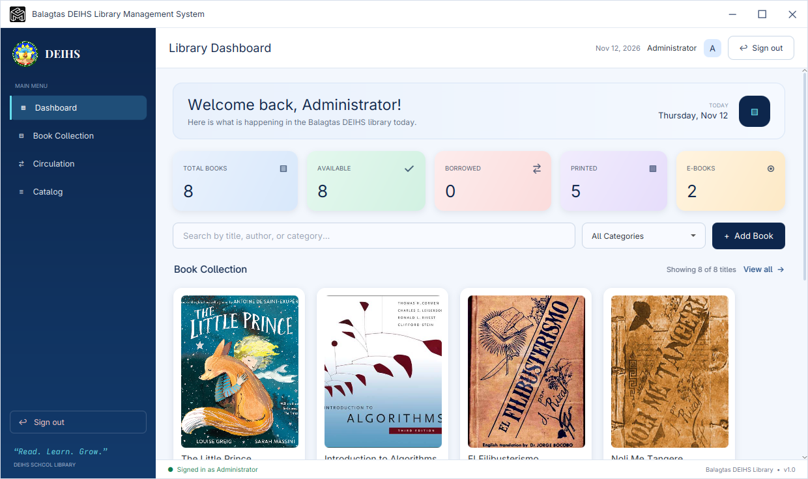

# Balagtas DEIHS Library Management System

A modern desktop library management system for **Balagtas DEIHS**, built with
**JavaFX** and **MySQL/MariaDB**. It replaces the old Swing prototype with a
clean dashboard, a visual book-cover collection, a borrowing desk, and a
maintainable catalog.



---

## Features

| Area | What it does |
| --- | --- |
| **Sign in / out** | Multiple user accounts, no roles. The first account is the built-in administrator. New accounts can be created from the sign-in screen. Use **Sign out** in the top bar (or at the bottom of the sidebar) to return to the login screen. |
| **Dashboard** | Live counters (total titles, available, on loan, categories, users), search, category filter, and the newest covers. |
| **Collection** | Full grid of book covers with title, author, category and availability. Click any cover to edit the title. |
| **Circulation** | Borrow and return books in one click. Availability, borrower name and loan state are saved to the database immediately. |
| **Catalog** | Add, edit and delete titles, including cover images. Deleting a title also removes its stored cover file. |
| **Cover photos** | Upload a JPG/PNG for any book. When a title has no cover, the app draws a gradient placeholder jacket so the grid never looks broken. |

The interface uses a navy full-height sidebar, pastel statistic cards and a
consistent light-blue theme defined in a single stylesheet.

---

## Requirements

- **JDK 21 or newer** (the build targets Java 21; it runs on later JDKs)
- **Maven 3.8+**
- **MySQL 8** or **MariaDB 10.6+** running locally or on the network
- A graphical desktop session (JavaFX needs a display)

Check your toolchain:

```bash
java -version
mvn -version
```

---

## 1. Create the database

The schema, the default administrator and eight sample titles are all in
`database/schema.sql`.

```bash
mysql -h 127.0.0.1 -P 3306 -u root -p < database/schema.sql
```

For MariaDB the command is the same (`mariadb` also works):

```bash
mariadb -h 127.0.0.1 -P 3307 -u root < database/schema.sql
```

The script creates the `deihs_library` database, the `users` and `books`
tables, and seeds the catalog. It is safe to re-run: existing rows are kept.

Verify the import:

```bash
mysql -h 127.0.0.1 -P 3306 -u root -p -e "SELECT COUNT(*) FROM deihs_library.books;"
```

---

## 2. Point the app at your database

Connection settings live in
`src/main/resources/db.properties`:

```properties
db.host=127.0.0.1
db.port=3307
db.name=deihs_library
db.user=root
db.password=
```

Edit that file to match your server. Every value can also be overridden at
launch time without touching the file — handy when the database is on another
PC:

```bash
mvn javafx:run -Ddb.host=192.168.1.10 -Ddb.port=3306 -Ddb.user=library -Ddb.password=secret
```

> **Note:** the bundled `db.properties` targets MariaDB on port **3307**. Change
> `db.port` to `3306` for a default MySQL installation.

---

## 3. Run the application

From the project folder:

```bash
./run.sh
```

or directly with Maven:

```bash
mvn javafx:run
```

The first launch compiles the sources automatically. If the database is
unreachable the app shows a clear error dialog naming the host, port and
database it tried.

### Build a runnable jar (optional)

```bash
mvn package
java --module-path "$JAVA_HOME/javafx/lib" \
     --add-modules javafx.controls \
     -jar target/deihs-library-hub-1.0.0.jar
```

A JavaFX runtime (SDK) must be on the module path when launching the packaged
jar.

---

## Default login

| Username | Password | Notes |
| --- | --- | --- |
| `admin` | `admin123` | Built-in administrator account |

Create additional accounts with **“Create an account”** on the sign-in screen.
Passwords are stored as a SHA-256 hash of `username:password`, never in plain
text.

> Change the administrator password after the first run if the system will be
> used by real staff.

---

## Where cover photos live

Uploaded covers are written to the **`covers/`** folder next to the project
root (created automatically). The database stores only the generated filename
in `books.cover_file`, for example:

```
covers/8f3c1d2e-....jpg
```

- Supported upload formats: JPG, JPEG, PNG, GIF, BMP, WEBP.
- Images are center-cropped to the card aspect ratio when displayed.
- Deleting a book from the Catalog removes its cover file as well.
- If a cover file is missing, a generated gradient jacket is drawn instead.

Because covers are stored on disk, keep the `covers/` folder with the
application and include it in backups alongside the database.

---

## Project layout

```
Balagtas DEIHS Library Management System/
├── database/schema.sql          Schema, admin account, sample books
├── covers/                      Uploaded cover images (created at runtime)
├── pom.xml                      Maven build (JavaFX 21, MySQL Connector/J)
├── run.sh                       Convenience launcher
└── src/main/
    ├── java/com/deihs/library/
    │   ├── App.java             Entry point, scene switching
    │   ├── db/Db.java           Connection pool/config
    │   ├── dao/                 UserDao, BookDao, exceptions
    │   ├── model/               User, Book
    │   ├── ui/                  LoginView, MainView, DashboardView,
    │   │                        CollectionPanel, CirculationView,
    │   │                        CatalogView, BookFormView, BookCard
    │   └── util/                Covers, Passwords
    └── resources/
        ├── css/app.css          Complete visual theme
        ├── db.properties        Connection settings
        └── images/deihs-logo.png
```

---

## How it works

- **Authentication** — `UserDao.authenticate` hashes `username:password` with
  SHA-256 and compares it to `users.password_hash`.
- **Persistence** — every action calls a DAO method, so the database is always
  the source of truth. Refreshing a page re-queries MySQL.
- **Availability** — `books.borrowed`, `borrower` and `borrowed_at` track the
  loan. The Circulation screen flips them in one click.
- **Editing** — clicking a cover or using **Edit** in the Catalog opens the same
  form; it returns a `Book` and the caller saves it, so add and edit behave
  identically.

---

## Troubleshooting

| Symptom | Fix |
| --- | --- |
| “Cannot connect to the library database” | Confirm MySQL/MariaDB is running, the port matches `db.properties`, and the schema was imported. |
| “Access denied for user” | Update `db.user` / `db.password`, or grant the user access to `deihs_library`. |
| `Unknown database 'deihs_library'` | Run `database/schema.sql`. |
| Window does not open on a server | JavaFX needs a display. Use a desktop session, or run with a virtual display (e.g. `xvfb-run mvn javafx:run`). |
| Covers show placeholders | The `covers/` folder or the file named in `books.cover_file` is missing. Re-upload the cover. |

---

## Notes

- The legacy `Book1.java` file in the project root is the original prototype and
  is **not** part of the Maven build.
- The app targets Java 21 bytecode but is tested on newer JDKs.
